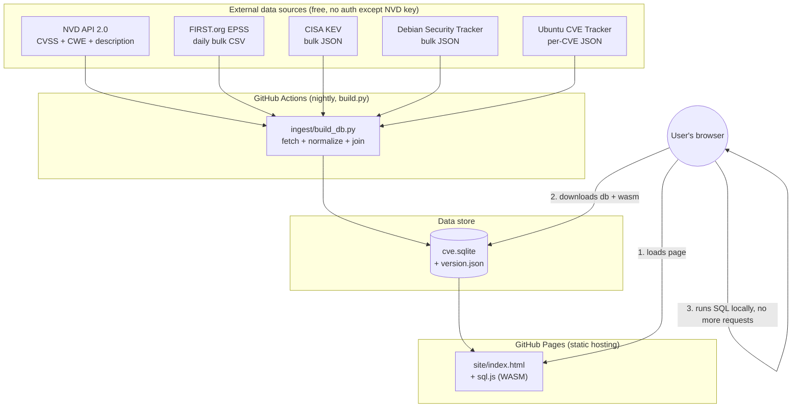

# CVE Scanner

A free, serverless CVE aggregator. It joins MITRE/NVD CVE data with CVSS,
CWE, EPSS, CISA KEV / exploit availability, and Ubuntu/Debian package
status into one searchable SQLite database, rebuilt nightly by GitHub
Actions, and searched entirely client-side in the browser via sql.js
(SQLite compiled to WebAssembly) - no server, no database host, no
hosting cost.

## Data flow (DFD)



**Read this as:** the nightly Action (a process, not a server) is the only
thing that talks to the outside data sources. It writes a plain file
(`cve.sqlite`). GitHub Pages just serves that file as static bytes. The
user's own browser downloads the file once, then answers every search
using its own CPU - nothing about a "search" ever touches a server.

## Repo layout

```
cve-scanner/
├── .github/workflows/
│   └── update-cve-db.yml     # nightly cron: build DB, commit, deploy to Pages
├── ingest/
│   ├── config.py             # which CVEs/keywords to track, which releases to check
│   ├── schema.sql             # SQLite schema (cves, cwes, epss_scores, exploits, distro_status)
│   ├── fetch_nvd.py           # NVD API 2.0 client (CVSS, CWE, description)
│   ├── fetch_epss.py          # EPSS daily bulk CSV
│   ├── fetch_kev.py           # CISA KEV bulk JSON
│   ├── fetch_debian.py        # Debian Security Tracker bulk JSON
│   ├── fetch_ubuntu.py        # Ubuntu per-CVE JSON API
│   ├── build_db.py            # orchestrator: runs all fetchers, writes cve.sqlite + version.json
│   └── requirements.txt
└── site/
    ├── index.html              # frontend: sql.js + search UI, fetches cve.sqlite.gz
    ├── cve.sqlite.gz            # generated by the Action, committed automatically
    └── version.json             # generated by the Action, committed automatically
```

## How to run this yourself

### 1. Push this repo to GitHub

```bash
git init
git add .
git commit -m "initial commit"
git branch -M main
git remote add origin https://github.com/<your-username>/cve-scanner.git
git push -u origin main
```

### 2. (Recommended) get a free NVD API key

Without a key, NVD limits you to 5 requests/30s; with one, 50 requests/30s.
Get one free at <https://nvd.nist.gov/developers/request-an-api-key> - no
approval wait, the key arrives by email in minutes.

Add it to your repo: **Settings → Secrets and variables → Actions → New
repository secret**, name `NVD_API_KEY`, paste the key.

### 3. Enable GitHub Pages

**Settings → Pages → Build and deployment → Source: GitHub Actions.**
That's it - no branch to pick, the workflow handles deployment.

### 4. Run the workflow once by hand

**Actions tab → update-cve-db → Run workflow.** This does a full build
immediately instead of waiting for the nightly cron. Takes a few minutes
(mostly NVD rate-limit sleeps).

### 5. Open your site

`https://<your-username>.github.io/cve-scanner/` - try searching
`openssl`, `log4j`, or any CVE ID from your `config.py` seed list.

### 6. Watch it stay fresh

The workflow reruns automatically every night at 18:00 UTC (a few hours
after EPSS publishes its daily scores around 13:30 UTC), commits the
refreshed `cve.sqlite.gz` + `version.json`, and redeploys Pages. You can
also trigger it manually anytime from the Actions tab.

## Customizing what gets tracked

Edit `ingest/config.py`:

- `SEED_CVE_IDS` - specific CVEs you always want in the database (e.g.
  ones relevant to packages in your own container images)
- `SEED_KEYWORDS` - NVD keyword searches that pull in related CVEs each
  run (e.g. `"openssl"`, `"glibc"`, your own vendor/package names)
- `UBUNTU_RELEASES` / `DEBIAN_RELEASES` - which distro releases to check
  package status against

## Scaling to a full database

This starter tracks a seed list, which keeps each Action run fast and
free. To grow toward "every CVE ever," swap two pieces:

1. **Replace `fetch_nvd.py`'s keyword search** with a bulk sync against
   `git clone https://github.com/CVEProject/cvelistV5.git` (updated by
   MITRE's own automation, no rate limit at all since it's just git) for
   the full CVE list, and use NVD's `lastModStartDate`/`lastModEndDate`
   params for incremental CVSS/CWE enrichment instead of keyword search.
2. **Replace `fetch_ubuntu.py`'s per-CVE loop** with a bulk clone of
   `git clone https://git.launchpad.net/ubuntu-cve-tracker` instead of
   one request per CVE.

At that scale, also add a version-check split in the frontend: keep a
small "search index" SQLite (cve_id, severity, cvss, short description)
for instant full-text search, and lazy-fetch a per-CVE JSON detail file
only when the user clicks a result - see the "priority sort" idea below
for why that's worth doing regardless of scale.

## Why sql.js instead of a hosted database

No server ever executes a query on your behalf, so there's no database
bill, no uptime to manage, and no per-request cost no matter how many
people use it. The tradeoff: the whole searchable dataset has to fit in
the file the browser downloads. For a seed-list scale project (dozens to
low thousands of CVEs) this is trivially fine; see "Scaling to a full
database" above for the split that keeps it fine at NVD's full ~260k-CVE
scale too.

## Prioritization: `cve_priority` view

`schema.sql` includes a view that combines CVSS, EPSS, and KEV status
into one `triage_bucket` column (`act now` / `high priority` / `monitor`
/ `low priority`), since sorting by CVSS alone hides the difference
between "severe but nobody's exploiting it" and "moderate but actively
being hit right now." Query it directly:

```sql
SELECT cve_id, triage_bucket, cvss_score, epss_score
FROM cve_priority
ORDER BY in_kev DESC, epss_score DESC;
```

## Costs

Everything here runs on GitHub's free tier for public repos: unlimited
Actions minutes on standard runners, free Pages hosting, free Release/
repo storage for a database this size. The only thing that could
eventually cost money is Pages bandwidth if the site gets very popular,
which is far outside where a project like this typically lands.
